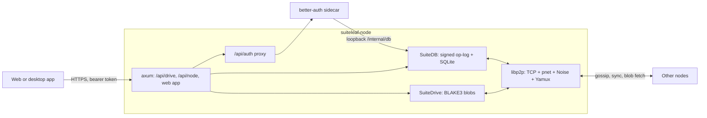

# Architecture

A React renderer is shared by Vite’s static build and electron-vite’s renderer build. It runs in one of three modes, resolved at startup by [`apps/web/src/mode.ts`](../apps/web/src/mode.ts):

| Mode | Storage | On-device assistant | How it is chosen |
| --- | --- | --- | --- |
| Serverless | This browser | In the page, on WebGPU | The GitHub Pages demo, built with `VITE_SUITELEAF_DEMO=1`. Locked. |
| Single-node | Files on disk, with the library index in SQLite | On this computer (llama.cpp), or an OpenAI-compatible endpoint. FrogNano by default. | The desktop app, until **Connect to a server**. |
| Cluster | SuiteDrive on a SuiteLeaf server, with a local offline cache | On the SuiteLeaf server, or an OpenAI-compatible endpoint. FrogNano by default. | Automatic when a server serves the web app. Otherwise **Connect to a server**, saved in the desktop settings file or browser storage. |

Serverless mode and single-node mode need no backend and show no account or SuiteDrive UI. Outside serverless mode the assistant settings choose a SuiteLeaf server or an OpenAI-compatible `/v1/completions` endpoint, and the model name. FrogNano is the default. On this computer, the desktop app downloads the selected built-in model the first time you ask, if that GGUF is not already on disk, and runs it. A cluster client asks the server. The server does the same download when `ai.upstream` is unset, and forwards the prompt to `ai.upstream` when it is set. A statically hosted web app that is not the demo can connect to a server. In cluster mode every route sits behind sign-in, the home screen lists SuiteDrive, and New, Open, and Save as work in SuiteDrive; see [Nodes, SuiteDB, auth, and SuiteDrive](#nodes-suitedb-auth-and-suitedrive). Hash routing supports arbitrary static hosts and the desktop `suiteleaf://app/` protocol. The home screen loads file metadata; editor modules are loaded only when a document or spreadsheet opens.

The persisted value is still `single` or `cluster`. Serverless mode is that `single` value with the demo build's lock (`demo: true` in `ResolvedMode`). Single-node mode is `single` inside the desktop app, where `window.suiteleaf` is present.

## Portable files

`packages/core` defines the version-1 JSON envelope, saved as `.sldoc`, `.slsheet`, or `.slslides` by kind (legacy `.suiteleaf` still opens; see [file format](file-format.md)): `format`, `version`, `id`, `kind`, `title`, `createdAt`, `updatedAt`, and `content`. Docs content is Tiptap JSON with embedded image data. Sheets content includes a Univer workbook snapshot, chart definitions, and pivot definitions. Editor snapshots retain their native styles, formula expressions/results, plugin resources, and worksheet IDs. Definitions reference worksheets by ID rather than their editable names.

Zod validates the envelope and essential workbook/cell structure. Native imports reject newer versions, malformed ranges, missing worksheets, unsafe document links, and external image references before persistence. Version 1 is the initial schema; future incompatible changes must introduce an explicit migration. JSON exports are portable data, not executable editor extensions.

## Storage and save ordering

`StorageAdapter` provides `list`, `get`, `save`, `remove`, `open`, `saveAs`, and `reload`. Browser storage uses Dexie/IndexedDB with indexed metadata and bounded native JSON chunks. Atomic migrations preserve existing version-1 files; large JSON is split into 4 MB IndexedDB chunks with metadata committed in the same transaction. Storing JSON avoids expensive browser structured-clone traversal over millions of cell objects. Electron’s typed `DesktopBridge` adds native exports, printing, menu events, and dirty-state notifications. The renderer cannot authorize arbitrary filesystem paths: native dialogs and the main-process recent-file catalog determine writable locations.

Editor changes update an in-memory file, followed by a debounced save. Explicit saves flush pending spreadsheet snapshots. A save queue preserves ordering and prevents failed writes from poisoning subsequent retries. Saved status corresponds to completed persistence and the latest edit revision. Browser Web Locks prevent concurrent editing of a single file in separate tabs.

The desktop catalog also serves as recovery storage. Before replacing a file, the main process persists its draft, checks the file’s SHA-256 fingerprint, writes a temporary sibling file, fsyncs it, and renames it over the original. Conflicts and missing originals preserve the draft. Save As writes to a user-approved new path; reload deliberately discards the draft in favor of the current disk file.

## Editors and analysis

Tiptap implements document editing and ProseMirror history; SuiteLeaf supplies the office toolbar, outline, find/replace, and format imports/exports. Documents use continuous layout and native print pagination.

Univer owns cell rendering, formula calculation, selection, clipboard, formatting, sorting/filtering, and its normal undo/redo history. SuiteLeaf persists workbook snapshots after mutations. Its custom chart components use the open source floating-DOM API, with Recharts rendering calculated source values. Source ranges adjust after row/column insertions and deletions; deleted sources are marked invalid. Sources use fixed inclusive rectangles rather than entire-column references.

Pivots use Arquero aggregation with named field selections. Numeric aggregates ignore nonnumeric values; COUNT counts nonempty value entries. Empty grouping fields form a blank group, and absent intersections are blank cells. An equality filter precedes aggregation. Source filters in the grid do not restrict the analysis range. Pivot results refresh explicitly and are protected against ordinary editing; an editable copy detaches its values from the definition.

## Desktop and distribution

Electron runs a sandboxed renderer with Node integration disabled and context isolation enabled. The main process validates IPC provenance and native file content. A scoped protocol serves bundled assets, navigation is restricted, and only clipboard permissions needed by the trusted editor are allowed. The content policy permits local assets, inline styles required by editors, and JavaScript evaluation required by spreadsheet/data engines; imported document content is sanitized and cannot supply scripts.

Production dependency notices accompany web assets and desktop packages. Books and research materials are excluded. Static hosting alone does not provide user accounts or cross-device synchronization; a SuiteLeaf node does. Signing, notarization, deployment, and automatic updates remain separate release tasks.

## Office conversion

`@suiteleaf/core/office` is the shared DOCX/XLSX conversion boundary. It checks package signatures, encryption, required parts, XML and expansion limits before producing a version-1 native file. Browser imports run in a dedicated module worker; Electron imports run in a Node worker. Native Open converts Office files into recovery drafts; Save As writes `.suiteleaf` and never replaces the DOCX/XLSX original. Compatibility information is stored in optional `importInfo` metadata and displayed in the editor.

Mammoth handles Word semantics, while a whitelist HTML-to-Tiptap adapter strips executable markup and unsafe links. Original body paragraphs are audited against the resulting text; missing paragraphs are recovered into a labelled section. Deeply nested layout can fall back to editable paragraphs. Header/footer text is appended as labelled sections. Supported raster images are embedded; unsupported image formats are labelled and reported.

SheetJS supplies cell types, Unicode, shared/array formulas and caches. OOXML styles and worksheet metadata provide fonts, fills, borders, alignment, number formats, dimensions, merges, hidden sheets, frozen panes, the date system and named ranges. Dense parsing and releasing source cell structures keep large imports within bounded memory. ZIP headers are normalized through JSZip and a Pako adapter replaces the spreadsheet library’s inflater to avoid hangs on valid archive layouts. Spreadsheet cell validation checks the graph in place rather than deep-cloning millions of cells during every native save. Basic charts are recreated when their cell ranges are representable; unsupported Excel features are recorded rather than claimed as preserved.

Corpus verification uses the identical converter and native validator in isolated processes, with immutable source snapshots and per-file original hash checks. Successful conversion/native round trip is distinct from visual or calculation parity with Word/Excel. Corrupt/encrypted rejection, capacity rejection and unexpected failure have separate result categories.

## Nodes, SuiteDB, auth, and SuiteDrive

A SuiteLeaf node is one Rust binary, `suiteleaf-node`, plus a small better-auth sidecar. Nodes form a private libp2p cluster and each holds a complete copy of everything.

| Crate or package | Role |
| --- | --- |
| [`crates/suiteleaf-net`](../crates/suiteleaf-net) | The swarm. TCP inside a private network (shared `swarm.key`), then Noise and Yamux, with identify, ping, Kademlia, optional mDNS, gossipsub, and two request/response protocols. |
| [`crates/suitedb`](../crates/suitedb) | The replicated database. See [SuiteDB](suitedb.md). |
| [`crates/suitedrive`](../crates/suitedrive) | Content-addressed file storage plus SuiteDB metadata tables. |
| [`crates/suiteleaf-node`](../crates/suiteleaf-node) | The binary. It holds config, keys, replication wiring, the HTTP API, and auth sidecar supervision. |
| [`services/auth`](../services/auth) | better-auth with a SuiteDB adapter. |

**Authentication.** better-auth handles email/password and username login, Google, GitHub, and Nextcloud (through `genericOAuth`). Its admin and organization plugins provide roles and teams. The sidecar never touches SQLite: its adapter sends every read and write to the node over loopback, so accounts, sessions, and signing keys replicate like any other table. better-auth's own adapter test suite runs against a live node.

Any node can authenticate a request from its local copy, without contacting the sidecar:

- A bearer JWT is verified against the Ed25519 public keys in the replicated `jwks` table.
- A bearer session token or session cookie is looked up in the replicated `session` table.

Social sign-in has to start on the node's own origin so the OAuth state cookie lands there. The app opens `/api/auth/suiteleaf/start`, which redirects to the provider. When the provider returns, the node redirects back to the app's `#/auth-complete` route with a one-time token, and the app exchanges that token for a session. Electron runs this hand-off in a child window.

**SuiteDrive.** File content is split into 1 MiB chunks, each stored under its BLAKE3 hash. A manifest lists the chunks, and the manifest's hash is the content hash. Three SuiteDB tables hold the metadata:

- `drive_item`: files and folders, including each file's head version.
- `drive_version`: every saved version.
- `drive_acl`: sharing with users or organizations, inherited down the folder tree.

When a `drive_version` row arrives from a peer, the node fetches the missing blobs over `/suiteleaf/drive/blob/1` and verifies every hash. A read that arrives before replication finishes fetches the blobs on demand.

Saves send `If-Match` with the version the editor loaded. A stale save returns 409, and the editor then offers to reload the SuiteDrive version or save a copy. If two nodes accept saves at the same moment, last-writer-wins picks the head, and the other version stays in the file's history.

**Editors and storage.** A file opened from SuiteDrive is cached in the local library with a `drive` link that records the node, item, and version. Autosave writes locally first, then uploads to SuiteDrive about 1.5 seconds after editing stops. If the upload fails, the edits stay safe on the device.

**Clients.** The web and desktop apps are cluster clients; they never run a server. The desktop app stores its mode in the user-data `settings.json`, switches with **Server → Connect / Disconnect**, and runs social sign-in in a child window. Files from single-node mode stay on the computer and are hidden in cluster mode; cached copies of SuiteDrive files are hidden in single-node mode.

**Deployment.** [`deploy/`](../deploy) has a Dockerfile and a three-node compose cluster.
